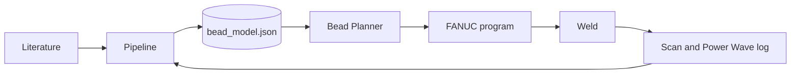

# great_beads

Bead geometry control for robotic WAAM: GMAW, 1.0 mm wire, beads on steel plate first, single-bead walls next.
Research stay EL-AD26-356, Landers Research Group, University of Notre Dame.

| Part | Folder | Turns this | Into this |
|---|---|---|---|
| Pipeline | `src/great_beads/` | Revopoint scan, Power Wave log, run sheet | measured beads, fitted laws |
| Model | `model/` | fitted laws | `bead_model.json`, the only file the planner reads |
| Bead Planner | `planner/` | model, target bead, plate touches | 3D prediction, FANUC program lines |
| Docs and DevLog | `docs/` | decisions, methods, results | the record of how the model was built |



The architecture, its variables and the decisions behind it are in [docs/architecture.md](docs/architecture.md).

## Baseline

`notebooks/waam_bead_morphology_7.ipynb` and Bead Planner 2.0 in `planner/` are the starting point, imported unchanged. The package takes over the notebook one section at a time; each step is a DevLog entry in `docs/devlog/`.

## Planner

Open `planner/index.html` with a double click, or press F5 in VS Code with this folder open. No install, no server, no internet.

## Pipeline

```bash
python -m venv .venv
. .venv/bin/activate              # Windows PowerShell: .venv\Scripts\Activate.ps1
pip install -e ".[dev,plots]"
pytest
```

## Docs

```bash
pip install -e ".[docs]"
mkdocs serve
```

## Data

Raw scans and Power Wave exports stay out of git (`data/raw/`). `data/manifest.csv` records where each file is stored and its SHA-256. The run sheet lives in `data/runs/`.
