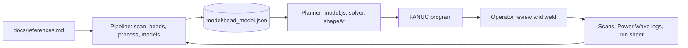

# Architecture

Decided on 2026-10-21 ([DevLog, Day 0](devlog/2026-10-21-day-0.md)).

## Variables

| Role | Variables | Set or read by |
|---|---|---|
| Commands | WFS, TS, V | robot and power source |
| Observed | I | Power Wave feedback |
| Geometry | A, h, w | scanner |

Current is not a command on the Power Wave R450 in this setup (notebook section 9). Tests 3, 8, D1 and W1 were all commanded at 300/25/18 and drew 186, 153, 149 and 161 A, while tests 3 and 8 laid 8.33 and 8.19 mm2.

## Relations

| | Relation | Form | Baseline |
|---|---|---|---|
| R1 | Mass balance | $A = m\,\mathrm{WFS}/\mathrm{TS}$ | $m = 0.661$ mm2 ($\eta = 0.84$), 29 rows |
| R2 | Height law | $\ln h = a + b \ln A + c\,(V - 18)$ | rms 5.8 % |
| R3 | Profile | $A = \tfrac{2}{3}\,w\,h$, parabola from toe to toe | fixed on Day 0 |
| R4 | Current | $I = f(\mathrm{WFS}, V)$ | $I \approx 9.5 + 0.53\,\mathrm{WFS} + 1.3\,(V - 18)$, sd 13 A |

Seven variables and four relations leave three degrees of freedom. The solver takes any three independent pins and computes the other four, or reports which relation is over- or under-determined.

| Pinned | Solved | Use |
|---|---|---|
| WFS, TS, V | A, h, w, I | predict a bead |
| A, V, TS | WFS, h, w, I | planner "area" mode |
| h, w, TS | A, V, WFS, I | planner "shape" mode |
| A, WFS, TS | none | R1 over-determined |
| WFS, V, I | none | R4 over-determined |

Current is never used to solve for anything: its spread of 13 A turns into 25 in/min of WFS or 10 V of voltage. The solver predicts I with its band, the Power Wave log is set against it, and a large gap points at the stick-out or the contact tip.

## Open question: travel speed in the height law

With A and h pinned, R2 fixes V, so a change of TS moves only WFS and I. If TS, or the heat per millimetre $V I/\mathrm{TS}$, acts on h at a fixed area, R2 needs a term for it. The baseline cannot tell: a $\ln(\mathrm{TS}/25)$ term comes out at $-0.15 \pm 0.16$, because 23 of the 29 rows were welded at 25 in/min.

Test: $\lambda = 8$ at 18 V, welded at 160/20, 200/25 and 240/30, three beads each. Between repeats h varies by about 5 % (tests 3, 8 and D1: 1.88, 2.06 and 1.94 mm), the size of the effect being looked for.

## Data flow

## Rules

- `model/bead_model.json` is the only contract. The pipeline writes it; the planner reads it through `planner/js/model.js` (Chrome blocks `fetch` from `file://`) and never refits.
- Data stays out of the code: the run sheet in `data/runs/`, scan settings in `config/scans/`. A test id names one weld; the controller schedule is stored apart, because schedule numbers get re-entered.
- Per-scan outputs are kept as written; any table that pools scans is rebuilt from all of them.
- Processing functions return plain arrays and dicts, `plot_*` functions only draw, and each step has one method.
- A notebook section moves into the package when it reproduces the numbers of notebook v7. Python writes golden cases and the planner's JavaScript has to reproduce them.

## To resolve before the first export

1. Ends. The notebook models a start as an erf level plus a Gaussian hump with surplus S (37 mm3 for a first start). The planner uses exponential ramps of 3.7 and 2.6 mm, a 62 % hump 6 mm from the tip and half-elliptical caps. One of them goes into the contract.
2. Section 10 still holds the earlier plan (WFS 25 in/min, travel 6 mm/s, target 18 mm2) and gives an efficiency of 4.2 on the current data. It has to read m from section 11.
3. CLOSE_MM was 3.0 for `cloud0` and 6.0 for the other scans, and the fit pools rows from all three plates. Each row has to carry the settings it was measured with.
4. The planner draws a cos2 section. It moves to the parabola of R3.
