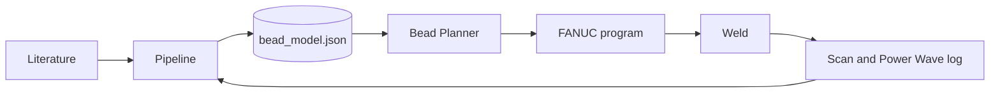

# great_beads

Bead geometry control for robotic WAAM (GMAW, 1.0 mm wire). Beads on plate first, single-bead walls next.

- [Architecture](architecture.md): variables, relations, the solver and the rules of the repository.
- [Pipeline](pipeline/index.md): scan and Power Wave log to measured beads and fitted laws.
- [Bead Planner](planner/index.md): the model turned into a 3D prediction and a FANUC program.
- [DevLog](devlog/index.md): what was done, why, and what it showed.
- [References](references.md): the methods and where the pipeline uses them.
